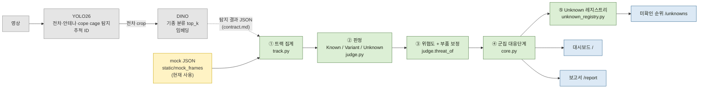
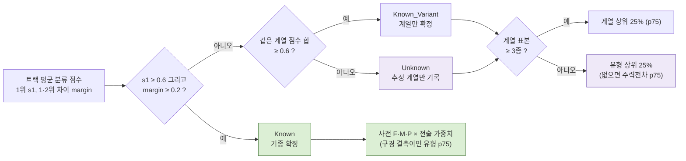
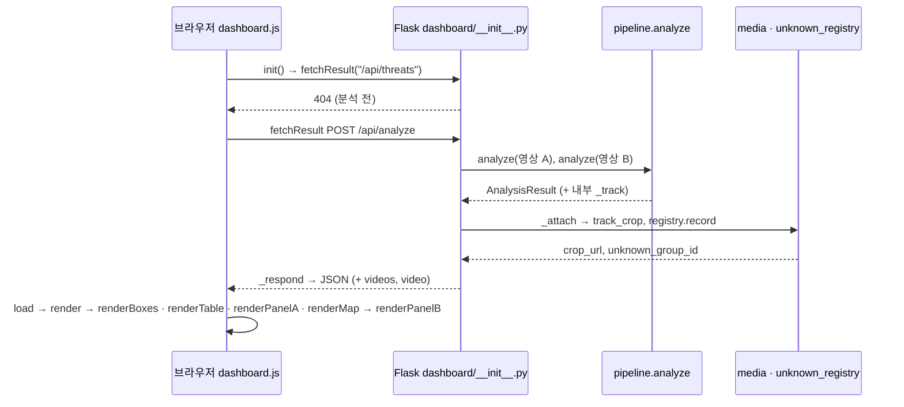

# 02. 전체 흐름도

그림 3개입니다. PNG 는 `정리/그림/흐름도_1_큰그림.png`, `흐름도_2_판정.png`, `흐름도_3_요청.png` (원본 Mermaid 는 아래).

---

## 1. 큰 그림 — 영상에서 화면까지

- **회색** = 모델 팀 영역 (아직 연결 전), **노란색** = 현재 대신 들어가는 mock, **초록색** = 우리 코드, **파란색** = 화면

| 단계 | 받는 것 | 하는 일 | 넘기는 것 |
|---|---|---|---|
| 모델 (YOLO26 → DINO) | 영상 | 프레임마다 전차 박스·부품·추적 ID, 전차 crop 의 기종 후보와 임베딩 | 탐지 결과 JSON (`dashboard/threat/contract.md`). **현재는 mock 파일이 대신함** |
| ① 트랙 집계 `track.aggregate` (`track.py:148`) | 프레임 단위 탐지 JSON | 같은 추적 ID 를 모아 안테나·cope cage 비율, 분류 점수 평균, 임베딩 평균, 대표 crop 후보 | 트랙 목록 |
| ② 판정 `judge.judge` (`judge.py:36`) | 트랙의 평균 분류 점수 | 1위 점수·1·2위 차이·계열 점수 합으로 Known / Known_Variant / Unknown | 상태, tank_id, 계열, 유형 |
| ③ 위협도 `judge.threat_of` (`judge.py:81`) | 판정 결과, 군집 전술, 지휘전차·cope cage 여부 | 사전 DB 값으로 전차 1대 위협도 T, cope cage 면 방호 ×1.10 | T, 보정 전 T, 근거 문장 |
| ④ 군집 대응단계 `core.cluster_response_level` (`core.py:113`) | 군집 안 표적들과 T | 제대(소대·중대·대대) × 최고 T = 군집점수 → 1~4단계, 하한 규칙 | 군집별 단계와 판정 근거 |
| ⑤ 레지스트리 `unknown_registry.record` (`unknown_registry.py:146`) | Unknown 표적(임베딩·위협도·crop) | 기존 그룹과 유사도 비교 → 같은 그룹 또는 새 그룹, 집계·순위, crop 저장 | 그룹 ID (DB 저장) |
| 화면 | API 응답 JSON | 표·박스·패널·지도, 미확인 순위, 보고서 | — |

---

## 2. 판정 흐름 — 위협도를 어디서 가져오나

| 단계 | 받는 것 | 하는 일 | 넘기는 것 |
|---|---|---|---|
| 판정 (`judge.py:50~62`) | 트랙 평균 top_k | 위 조건 순서대로 검사 | 상태 |
| Known 위협도 (`judge.py:88~97`) | 사전 행 (f·m·p) | T = (wF·F + wM·M + wP·P) / 가중치 합, cope cage 면 P×1.10 | T |
| 대체 위협도 (`judge.py:65~78`) | 계열 또는 유형 | 계열 표본 3종 이상이면 계열 p75, 아니면 유형 p75 → 주력전차 p75 | T, 근거('T-72 계열 상위25%' 등) |

샘플: Tank-01 → Known(T-90, 0.884 / 차이 0.826) · Tank-02 → Known_Variant(T-72 합 0.78) · UNK-001 → Unknown(0.222, 추정 T-90 → 표본 2 → 주력전차 p75).

---

## 3. 요청 흐름 — 브라우저에서 서버까지 (실제 함수 이름)

| 단계 | 받는 것 | 하는 일 | 넘기는 것 |
|---|---|---|---|
| `init` (`dashboard.js:35`) | 페이지 열림 | 버튼 연결, 지도 준비, 마지막 결과 요청 | GET `/api/threats` |
| `analyze` 라우트 (`dashboard/__init__.py:96`) | POST 본문 (없으면 mock A·B) | 영상마다 `pipeline.analyze`, 오류면 400 | 계산 결과 |
| `_attach` (`dashboard/__init__.py:55`) | 계산 결과 | crop 저장, Unknown 레지스트리 저장, 내부 필드 제거 | 화면용 결과 |
| `_respond` (`dashboard/__init__.py:83`) | 결과 | 영상 목록·현재 영상 추가 | JSON |
| `load` → `render` (`dashboard.js:85`, `:105`) | JSON | 화면 각 부분 다시 그리기, 1위 자동 선택 | 화면 |
