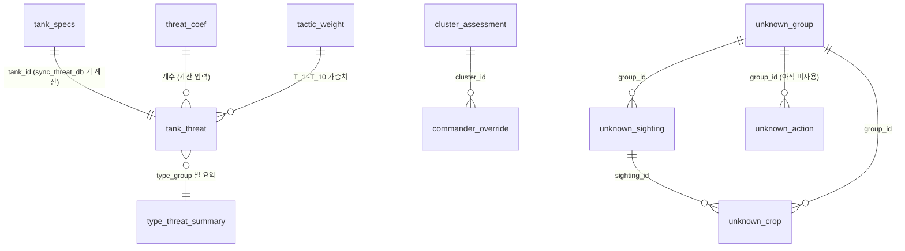

# 07. DB 구조

- **DB**(데이터베이스) = 표(테이블) 여러 개를 저장하는 프로그램. 이 프로젝트는 **MySQL**(DB 이름 `tank`)을 쓰고, `TANKLAB_DEMO=1` 이면 **SQLite** 파일(`tank_demo.sqlite3`)을 씁니다 (`threat_db.py:14~24`).
- 테이블 정의: `schema.sql` (사전 1개), `schema_threat.sql` (위협도·대응수준·레지스트리 12개).
- **PK**(Primary Key, 기본 키) = 행을 하나로 특정하는 값. 같은 값이 두 번 들어갈 수 없습니다.
- 예시 값은 2026-10-18 이 PC 의 MySQL 에서 읽은 실제 값입니다. 행 수(엔진 통합 후 시연 기준): tank_specs 369, tank_threat 369, type_threat_summary 80, cluster_assessment 3, commander_override 2, unknown_group 1, unknown_sighting 2, unknown_crop 6, unknown_action 0.
- **판정과 지휘관 조치는 DB 에 기록합니다** (엔진 통합 후): 대시보드 분석·재판정마다 `cluster_assessment` 1행(군집 ID = '영상:군집'), 지휘관 조치(전술·지휘전차·핵심표적·단계 조정)마다 `commander_override` 1행. 화면 상태(지정 전술·핵심표적 등)와 응답 JSON 은 서버 메모리(`dashboard/__init__.py:44` STATE)에 캐시로만 둡니다.

## ERD (테이블 관계도)

> 실제 DB 에 외래 키(FOREIGN KEY) 제약은 걸려 있지 않습니다. 위 관계는 코드가 같은 값으로 연결해 읽는다는 뜻입니다.

## 어떤 함수가 어느 테이블을 읽고 쓰나

| 테이블 | 쓰기 (INSERT/UPDATE/DELETE) | 읽기 (SELECT) |
|---|---|---|
| `tank_specs` | `load_xlsx.main` (`load_xlsx.py:31`, 새 테이블에 넣고 이름 바꿔 교체) | `dictionary.load_tanks` (`dictionary.py:26`), `sync_threat_db.load_dictionary` (`sync_threat_db.py:54`) |
| `threat_coef`, `ammo_coef`, `gen_coef`, `tactic_weight` | `sync_threat_db.seed` (`sync_threat_db.py:26`, 비어 있을 때 1회) | `sync_threat_db.load_coefs` (`:45`), `response_level.load_lookup` (`response_level.py:159`, threat_coef) |
| `tank_threat` | `sync_threat_db.sync` (`sync_threat_db.py:60`, 한 트랜잭션으로 교체) | `dashboard/threat/dictdb.py:26` `_from_db` (대시보드 위협도·p75), `response_level.load_lookup`, `dictionary.load_scores`·`load_threat` (`dictionary.py:286`, `:401`), `threat_api.tank` (`threat_api.py:74`) |
| `type_threat_summary` | `sync_threat_db.sync` | `dictdb._from_db`, `response_level.load_lookup` |
| `cluster_assessment` | `response_level.save_assessment` (`response_level.py:181`) ← 대시보드 `_attach` (`dashboard/__init__.py:63`), `assess_and_save` (`response_level.py:219`, /api/threat) | `response_level.latest_cluster` (`response_level.py:228`), `history` (`response_level.py:202`) |
| `commander_override` | `response_level.record_override` (`response_level.py:192`) ← 대시보드 `_log_action` (`dashboard/__init__.py:106`), `apply_override` (`response_level.py:235`) | `response_level.history` (`response_level.py:202`) → 보고서·`/api/clusters/<id>/history` |
| `unknown_group` | `unknown_registry.record`·`_refresh` (`unknown_registry.py:138`, `:107`) | `_match`, `_group`, `_new_group_id`, `ranking`, `detail` |
| `unknown_sighting` | `unknown_registry.record` | `_refresh`, `lookup` (`unknown_registry.py:179`), `detail` (`unknown_registry.py:203`) |
| `unknown_crop` | `_save_crops` (`unknown_registry.py:126`), `_prune` (삭제, `unknown_registry.py:116`) | `_cover` (`unknown_registry.py:187`), `detail` |
| `unknown_action` | **없음 (TODO: 확정·병합·기각 기능과 함께)** | — |

---

## 사전

### `tank_specs` — 전차 제원 원본 (`schema.sql:9~45`, 369행)

엑셀 `tank_dictionary_v2.xlsx` 를 그대로 옮긴 표. 사전 화면이 읽고, 위협도 계산의 입력입니다.

| 컬럼 | 타입 | 의미 | 예시 (TANK_0230) |
|---|---|---|---|
| tank_id | VARCHAR(32) PK | 전차 ID | TANK_0230 |
| canonical_name | VARCHAR(100) | 정식 명칭 | T-90 |
| aliases | VARCHAR(255) | 별칭 (' \| ' 구분) | T-90 MBT |
| family_name | VARCHAR(100) | 계열 | T-90 |
| variant_name | VARCHAR(100) | 변형 (단일 모델은 Base) | Base |
| tank_type | VARCHAR(100) | 유형 | 3세대주력전차 |
| generation | VARCHAR(100) | 세대 | 3세대 전차, 3.5세대 전차 |
| origin_country / manufacturer | VARCHAR | 개발국 / 제조사 | 러시아 / 러시아 |
| service_year | VARCHAR(255) | 도입 연도 (자유 형식) | 1993 |
| operator_countries | VARCHAR(255) | 운용국 | 러시아 |
| crew | TINYINT | 승무원 | 3 |
| combat_weight_t, length_m, width_m, height_m | DECIMAL | 전투중량(t)·전장·전폭·전고(m) | 46.00, 6.86, 3.78, 2.23 |
| main_gun / main_gun_caliber_mm | VARCHAR / DECIMAL | 주포 설명 / 구경(mm) | 48구경장 125mm 2A46M-5 활강포 / 125.0 |
| main_ammunition | VARCHAR(255) | 주력 탄약 | 활강포 42발 |
| effective_range_m | INT | 유효 사거리 | (없음) |
| secondary_weapons | VARCHAR(255) | 부무장 | 12.7mm Kord … |
| armor_description | TEXT | 장갑 설명 | 용접포탑, 복합장갑, 반응장갑(콘탁트-5) |
| era / aps / defense_systems | VARCHAR | 반응장갑 / 능동방호 / 기타 방호 | 반응장갑(ERA) / 능동방어체계(APS) … / NBC 방호 |
| engine / engine_power_hp | VARCHAR / INT | 엔진 / 출력(hp) | V-84MS V12 디젤 / 840 |
| power_to_weight_hp_t | DECIMAL | 출력대중량비(hp/t) | 18.20 |
| max_road_speed_kmh / range_km | DECIMAL / INT | 최고속도 / 항속거리 | 60.0 / 550 |
| sources / source_count | VARCHAR / TINYINT | 출처 / 출처 수 | Namuwiki … |
| spec_count / spec_coverage_% | INT / DECIMAL | 채워진 제원 수 / 충족률(%) (적재 때 계산) | — |

---

## 위협도 (사전 → 계산)

### `threat_coef` — 기준값·경계값 (`schema_threat.sql:5~9`)

| 컬럼 | 타입 | 의미 | 예시 |
|---|---|---|---|
| k | VARCHAR(32) PK | 이름 | cal, len, pw, h, hmin, hmax, lv1, lv2, lv3, floor_t |
| v | DOUBLE | 값 | 120, 44, 26.22, 2.44, 0.85, 1.15, 225, 150, 75, 75 |
| note | VARCHAR(255) | 설명 | 구경(mm) |

### `ammo_coef`, `gen_coef` — 탄종·세대 계수 (`:11~19`)

| 테이블 | 컬럼 | 예시 |
|---|---|---|
| ammo_coef | ammo (PK), coef | APFSDS 1.0, 포발사 ATGM 0.8, HEAT 0.6, APDS 0.55, APCR 0.35, HESH 0.35, AP(철갑탄) 0.25, HE 0.15 |
| gen_coef | gen (PK), coef | 3.5세대 1.1, 3세대 1.0, 2세대 0.75, 1세대 0.55, 구형/미상 0.4 |

### `tactic_weight` — 전술 가중치 (`:21~28`)

| 컬럼 | 타입 | 의미 | 예시 (10번) |
|---|---|---|---|
| tactic_no | TINYINT PK | 전술 번호 1~11 | 10 |
| name | VARCHAR(32) | 이름 | 지휘통제 |
| w_f / w_m / w_p | DOUBLE | 화력·기동·방호 가중치 | 0.19 / 0.43 / 0.37 |
| tank_allowed | TINYINT | 전차에 쓰는지 (11번만 0) | 1 |

> 대시보드는 같은 값을 `dashboard/threat/config.py:26~37` 에도 가지고 있습니다(두 곳 — 12번 문서).

### `tank_threat` — 기종별 위협도 (`:31~59`, 369행 중 계산 가능 287)

| 컬럼 | 타입 | 의미 | 예시 (TANK_0230) |
|---|---|---|---|
| tank_id | VARCHAR(32) PK | 전차 ID | TANK_0230 |
| canonical_name, family_name | VARCHAR | 이름, 계열 | T-90, T-90 |
| type_group | VARCHAR(16) | 표준 유형 | 주력전차 |
| computable | TINYINT | 계산 가능 여부 (구경 결측이면 0) | 1 |
| confidence | VARCHAR(4) | 데이터 신뢰도 상/중/하 (대체값 개수 기준) | 상 |
| cal_mm, cal_len, ammo, gen, pw, armor, height | DOUBLE/VARCHAR | 계산 입력값 | 125, 48, APFSDS, 3세대, 18.2, 0.8, 2.23 |
| *_src (7개) | VARCHAR(64) | 각 입력값의 출처 (원본 / 텍스트 / 대체 규칙) | pw_src = 원본, gen_src = 수동 보정(검토 필요) |
| armor_rule | VARCHAR(128) | 장갑 계수 규칙 | 복합장갑(세대 차등) |
| era_ref, era_src | TINYINT, VARCHAR | 반응장갑 (참고용, 식에는 미반영) | 1, 수동 지정(검토 필요) |
| f, m, p | DOUBLE | 화력·기동·방호 (M1A1 = 1.0) | 1.0880, 0.6941, 0.8368 |
| t1 ~ t10 | DOUBLE | 전술별 위협도 (M1A1 = 100) | t1 90.0 … t10 82.3 |
| updated_at | DATETIME | 계산 시각 | 2026-10-18 12:26:53 |

### `type_threat_summary` — 유형별 요약 (`:62~70`, 80행 = 유형 8 × 전술 10)

| 컬럼 | 타입 | 의미 | 예시 |
|---|---|---|---|
| type_group, tactic_no | PK (둘 합쳐서) | 유형·전술 | 주력전차, 10 |
| n | INT | 계산 가능한 기종 수 | 88 |
| t_median | DOUBLE | 중앙값 | 80.55 |
| t_p75 | DOUBLE | 상위 25% (Unknown 대체값) | 88.93 |

---

## 판정·지휘관 조치 기록 (대시보드·`/api/threat` 공통)

### `cluster_assessment` — 군집 판정 기록 (`:73~85`, 3행)

판정 1건 = 1행. 대시보드와 `/api/threat` 가 같은 테이블에 씁니다. 예: `mock_video_A.mp4:C-1`, level 2, score 88.9, n_vehicles 3, tactic_no 10 (핵심표적 지정 뒤 재판정).

| 컬럼 | 타입 | 의미 |
|---|---|---|
| id | BIGINT PK (자동 증가) | 번호 |
| cluster_id | VARCHAR(64) | 군집 ID (대시보드는 `영상:군집`, 64자 넘으면 `response_level.cluster_key` 가 줄임) |
| level, score, t_cluster, echelon_e, n_vehicles, tactic_no | 숫자 | 단계, S, T_cluster, E, N, 전술 |
| input_json, result_json | TEXT | 판정 입력·결과 전체 (재판정용) |
| created_at | DATETIME | 기록 시각 |

### `commander_override` — 지휘관 수정 이력 (`:88~98`, 2행)

| 컬럼 | 타입 | 의미 |
|---|---|---|
| id | BIGINT PK | 번호 |
| cluster_id, actor | VARCHAR | 군집('영상:군집'), 조치한 사람 (X-User 헤더 → 본문 actor → 'commander') |
| item | VARCHAR(16) | tactic(전술) · commander(지휘전차) · core_target(핵심표적) · stage(단계 조정, 계산 안 바꿈). 가장 긴 값 11자라 길이 16 그대로 |
| before_value, after_value | VARCHAR(255) | 변경 전·후 (JSON). 예: `{"tracking_id": "Tank-01", "core": false}` → `{… "core": true}` |
| level_before, level_after | TINYINT | 단계 전·후 |
| created_at | DATETIME | 시각 |

---

## 미확인 레지스트리 (`dashboard/unknown_registry.py`)

### `unknown_group` — 미확인 그룹 (`:102~121`, 1행)

| 컬럼 | 타입 | 의미 | 예시 |
|---|---|---|---|
| group_id | VARCHAR(32) PK | 그룹 ID | UNK-G0001 |
| status | VARCHAR(16) | open / confirmed / merged / dismissed (현재 코드는 open 만 만듦) | open |
| family_guess, type_group | VARCHAR | 추정 계열(첫 표적 값), 유형 | T-90, 주력전차 |
| centroid | TEXT | 평균 임베딩 (JSON 숫자 목록) | [0.028, -0.322, …] (16개) |
| n_tracks, n_videos | INT | 고유 트랙 수, 고유 영상 수 | 2, 2 |
| max_threat, threat_source | DOUBLE, VARCHAR | 최고 위협도와 근거 | 99.5, T-80 계열 상위25% |
| has_cope_cage, commander_seen | TINYINT | cope cage 본 적 있음, 지휘전차로 나온 적 있음 | 1, 0 |
| priority | DOUBLE | 순위 점수 (저장 시점) | 277.5 |
| review_candidates | TEXT | 병합 후보 [{group_id, similarity}] | (없음) |
| confirmed_tank_id, merged_into | VARCHAR | 확정 기종, 병합 대상 (**기능 TODO**) | (없음) |
| first_seen, last_seen, updated_at | DATETIME | 처음·마지막 출현, 갱신 | 2026-10-18 00:00:00 |

### `unknown_sighting` — 출현 기록, 트랙 1개 = 1행 (`:124~139`, 2행)

| 컬럼 | 타입 | 의미 | 예시 |
|---|---|---|---|
| id | BIGINT PK | 번호 | 1 |
| group_id | VARCHAR(32) | 소속 그룹 | UNK-G0001 |
| video, tracking_id | VARCHAR | 영상, 추적 ID — **두 개를 합쳐 UNIQUE**(중복 저장 방지) | mock_video_A.mp4, UNK-001 |
| cluster_id | VARCHAR(64) | 군집 | C-1 |
| similarity | DOUBLE | 그룹에 들어갈 때 유사도 (새 그룹이면 NULL) | NULL (UNK-007 은 0.9646) |
| top_k_json, embedding | TEXT | 분류 후보, 임베딩 | [{"label": "TANK_0231", "score": 0.222 …}] |
| threat | DOUBLE | 위협도 | 88.9 |
| lat, lon | DOUBLE | 추정 위치 | 48.597343, 38.012528 |
| captured_at, created_at | DATETIME | 촬영일, 저장 시각 | 2026-10-18 00:00:00 |

### `unknown_crop` — 그룹 crop 사진 (`:141~149`, 6행)

| 컬럼 | 타입 | 의미 | 예시 |
|---|---|---|---|
| id | BIGINT PK | 번호 | 4 |
| sighting_id, group_id | BIGINT, VARCHAR | 출현 기록, 그룹 | 2, UNK-G0001 |
| path | VARCHAR(255) | static 기준 파일 경로 | unknown_crops/UNK-G0001/mock_video_B.mp4_UNK-007_124.jpg |
| quality | DOUBLE | 품질 점수 | 0.06239 |
| frame_idx | INT | 프레임 번호 | 124 |
| created_at | DATETIME | 저장 시각 | 2026-10-18 14:19:27 |

### `unknown_action` — 분석관 조치 이력 (`:152~159`, 0행)

| 컬럼 | 타입 | 의미 |
|---|---|---|
| id | BIGINT PK | 번호 |
| group_id, actor | VARCHAR | 그룹, 조치한 사람 |
| action | VARCHAR(16) | confirm / merge / split / dismiss |
| detail | TEXT | 상세 |
| created_at | DATETIME | 시각 |

> **테이블만 있고 쓰는 코드는 아직 없습니다 (TODO).**
