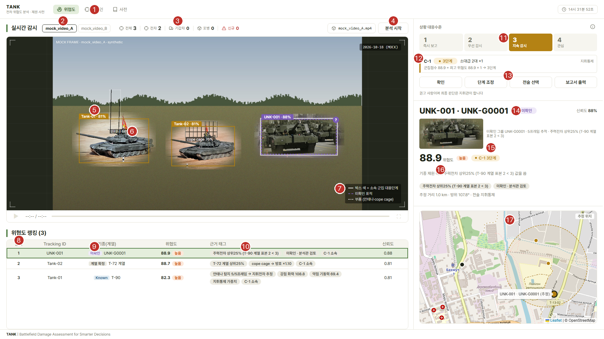
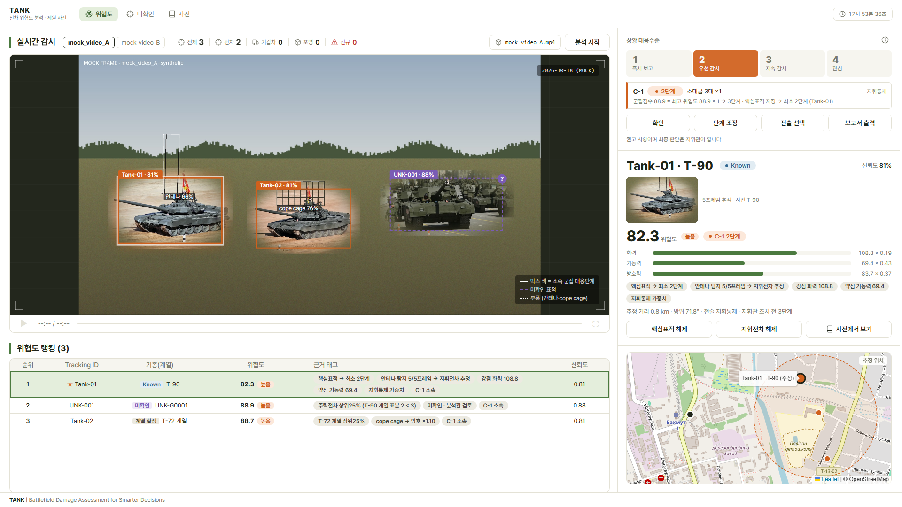
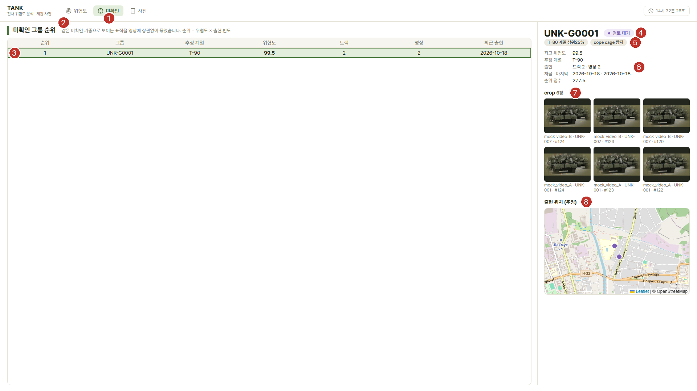

# 09. 화면 설명

캡처는 2026-10-18 실제 서버 화면입니다 (1920×1080, 샘플 데이터). 파일은 `정리/그림/`.

| 파일 | 화면 |
|---|---|
| `화면_1_대시보드_영상A.png`, `화면_1_대시보드_번호.png` | 대시보드 (영상 A) / 번호 표시판 |
| `화면_2_대시보드_영상B.png` | 대시보드 (영상 B) |
| `화면_3_상세패널.png` | 오른쪽 선택 표적 상세 패널 확대 |
| `화면_4_미확인_레지스트리.png`, `화면_4_미확인_레지스트리_번호.png` | `/unknowns` 그룹 순위·상세 |
| `화면_5_보고서.png` | `/report` 보고서 (핵심표적 지정·단계 조정 뒤, 조치 이력 포함) |
| `화면_8_핵심표적_지정.png` | 대시보드에서 Tank-01 을 핵심표적으로 지정한 화면 (엔진 통합 후) |
| `화면_6_전차사전_상세.png`, `화면_7_전차사전_홈.png` | 전차 사전 |

---

## 1. 대시보드 `/` — `화면_1_대시보드_번호.png`

| 번호 | 무엇을 보여 주나 | 데이터 출처 (응답 필드) | 그리는 코드 |
|---|---|---|---|
| 1 | 상단 메뉴: 위협도 · 미확인 · 사전 | — | `templates/_nav.html` |
| 2 | 영상 탭 (mock_video_A / B) | `videos`, `video` | `dashboard.js:120` `renderTabs` |
| 3 | 탐지 카운터: 전체·전차·기갑차·포병(+인원)·신규 | `counts` | `dashboard.js:189` `renderCountBar` |
| 4 | 분석 시작 버튼 | → `POST /api/analyze` | `dashboard.js:36` |
| 5 | 바운딩 박스: 색 = 소속 군집 대응단계, 미확인은 보라 점선 + '?', 라벨 'ID · 신뢰도' | `targets[].bbox`, `level`, `is_unknown`, `confidence` | `dashboard.js:137` `renderBoxes` |
| 6 | 부품 표시: 흰 점선 상자 + '안테나 66%', 'cope cage 76%' | `targets[].parts` | `dashboard.js:140~146` |
| 7 | 범례 (박스 색·미확인·부품) | — (고정 문구) | `index.html` |
| 8 | 위협도 랭킹 표: 순위·ID·기종·위협도·근거 태그·신뢰도 | `targets[]` (rank 있는 것) | `dashboard.js:207` `renderTable` |
| 9 | 판정 상태 배지: Known(파랑) / 계열 확정(회색) / 미확인(보라) + 기종 또는 그룹 ID | `status`, `model`, `unknown_group_id` | `dashboard.js:203` `statusBadge` |
| 10 | 근거 태그: 판단 이유 칩 | `tags` (서버 `pipeline.py:114` 이 만듦) | `dashboard.js:223` |
| 11 | 단계 사다리 1~4: 지금 단계 칸만 단계 색, 지휘관 조정 시 AI 권고 칸은 점선 | `alert.level` + 화면 상태 `commanderStage` | `dashboard.js:253` `renderPanelA` |
| 12 | 군집 카드: ID·단계·'소대급 2대 ×1'·전술, 판정 근거 | `clusters[]` | `dashboard.js:270~280` |
| 13 | 버튼: 확인 · 단계 조정 · 전술 선택 · 보고서 출력 | — | `dashboard.js:36~52` |
| 14 | 선택 표적 제목·판정 배지·신뢰도 | 선택 표적 | `dashboard.js:331` `renderPanelB` |
| 15 | 대표 crop 사진 + '미확인 그룹 · 5프레임 추적 · 근거' | `crop_url`, `unknown_group_id`, `n_frames`, `threat_source` | `dashboard.js:336~342` |
| 16 | 위협도 점수(보정 전 값), 단계 배지, 소속 군집 단계, 막대 또는 대체값 안내, 근거 태그, 추정 거리·방위 | `threat`, `threat_before_bonus`, `grade`, `scores`, `weights`, `position` | `dashboard.js:350~380` |
| 17 | 미니맵: 관측 지점(검은 점), 표적 추정 위치(단계 색), 군집 점선 원 | `source.observer`, `targets[].position`, `clusters` | `dashboard.js:417` `renderMap` |

### 엔진 통합 후 추가된 화면 요소 — `화면_8_핵심표적_지정.png`

| 요소 | 무엇을 보여 주나 | 데이터 출처 | 그리는 코드 |
|---|---|---|---|
| 랭킹 표 ★ | 지휘관이 지정한 핵심표적 (랭킹 맨 위) | `targets[].is_core` | `dashboard.js:207` `renderTable` |
| 근거 태그 '핵심표적 → 최소 2단계' | 핵심표적 때문에 군집이 최소 2단계 | `tags` (`pipeline.py:116`) | `renderTable`, `renderPanelB` |
| 군집 카드 근거 '핵심표적 지정 → 최소 2단계 (Tank-01)' | 적용된 하한 규칙 | `clusters[].reasons` (`adapter.py:56~58`) | `dashboard.js:253` `renderPanelA` |
| 상세 패널 '지휘관 조치 전 3단계' | 조치 전(AI) 단계 | `clusters[].level_before_override` | `dashboard.js:375~378` |
| 상세 패널 '핵심표적 지정/해제' 버튼 | 지정 ↔ 해제 | → `PATCH /api/threats/<ID>/core-target` | `dashboard.js:393` `toggleCore` |

- 박스·표 행·지도 마커 중 아무거나 누르면 같은 표적이 세 곳에서 함께 강조되고 상세 패널이 바뀝니다 (`dashboard.js:232` `selectTarget`).
- 처음 열면 1위 표적이 자동 선택됩니다 (`dashboard.js:115`).
- 지휘전차 지정·해제 버튼은 v2 전차를 골랐을 때 상세 패널 아래에 나옵니다 (`화면_3_상세패널.png` 의 UNK-001 은 '미확인' 분류라 버튼 없음).

## 2. 미확인 레지스트리 `/unknowns` — `화면_4_미확인_레지스트리_번호.png`

| 번호 | 무엇을 보여 주나 | 데이터 출처 | 그리는 코드 |
|---|---|---|---|
| 1 | 상단 메뉴 '미확인' (현재 화면) | — | `templates/_nav.html` |
| 2 | 제목과 설명 '순위 = 위협도 × 출현 빈도' | — | `unknowns.html` |
| 3 | 그룹 순위 표: 순위·그룹·추정 계열·위협도·트랙·영상·최근 출현 | `GET /api/unknowns` → `groups[]` | `unknowns.js:14` `init` |
| 4 | 선택 그룹 ID 와 상태(검토 대기 = open) | `group.group_id`, `status` | `unknowns.js:49` `show` |
| 5 | 칩: 위협도 근거 · cope cage 탐지 · 지휘전차와 함께 출현 | `threat_source`, `has_cope_cage`, `commander_seen` | `unknowns.js` `show` |
| 6 | 요약: 최고 위협도·추정 계열·출현(트랙·영상)·처음/마지막·순위 점수·병합 후보 | `GET /api/unknowns/<id>` → `group` | `show` |
| 7 | crop 갤러리 (품질 높은 순, 최대 12장) — 영상·표적·프레임 번호 | `crops[]` | `show` |
| 8 | 출현 위치 지도 (보라 점) | `sightings[].lat/lon` | `show` |

## 3. 보고서 `/report` — `화면_5_보고서.png`

작성 시각·영상·촬영일 → AI 권고 단계(지휘관 결정 단계) → 군집 표(단계·제대·전술·군집점수·근거) → 표적 랭킹 표(순위·ID·기종·위협도·단계·군집·근거 태그) → 순위 없는 표적. 브라우저 인쇄(Ctrl+P)로 PDF 저장. 코드: `dashboard/templates/dashboard/report.html`.

## 4. 전차 사전 `/dictionary`

- `화면_7_전차사전_홈.png`: 검색, 유형·세대 필터, 국가별 목록 (`dictionary.py:223` `home`).
- `화면_6_전차사전_상세.png`: 제원 표, 사진, 정량 위협도(전술 가중치 없는 `100×(F+M+P)/3`) (`dictionary.py:478` `tank`).

---

## 버튼별 동작 흐름

### 단계 조정 (지휘관 판단으로 전체 단계 바꾸기)
1. '단계 조정' 클릭 → 1~4단계 버튼 줄이 펼쳐짐 (`dashboard.js:38`, `togglePicker`).
2. 단계 클릭 → 화면 상태 `commanderStage` 에 저장 (`dashboard.js:41~47`). 계산값은 그대로.
   동시에 `POST /api/clusters/<가장 심각한 군집>/stage` 로 **이력에만 기록** (`dashboard.js:48~50` → `dashboard/__init__.py:253`). 단계 조정을 계산에 반영할지는 **팀 결정 필요**.
3. 사다리에 선택 단계는 칠하고 AI 권고는 점선, 'AI 권고 3단계 → 지휘관 결정 1단계' 문구 (`renderPanelA`).
4. 보고서의 '최종 단계'에 반영되고 `?stage=1` 로도 전달됨. 새 분석이 오면 화면의 조정은 풀립니다 (`dashboard.js:92`).

### 전술 선택 (군집 전술 지정)
1. '전술 선택' → 군집·전술(1~10, 자동) 고르기 → '적용' (`dashboard.js:295` `applyTactic`).
2. `PATCH /api/clusters/C-1/tactic {"tactic": 3}` → 서버가 그 군집 전차 위협도를 새 가중치로 다시 계산 (`dashboard/__init__.py:176` → `pipeline.analyze(tactic_overrides=…)`).
3. 응답으로 화면 전체 갱신. 군집 카드 전술이 주황 '대전차 (지정)'. 예: 영상 A → S 88.9 → 94.1. 판정과 조치(`tactic`)가 DB 이력에 남습니다.

### 지휘전차 지정·해제
1. 상세 패널의 '지휘전차 해제'/'지휘전차로 지정' 클릭 (`dashboard.js:383` `toggleCommander`).
2. `PATCH /api/threats/Tank-01/commander {"is_commander": false}` (탐지 규칙과 같은 값으로 되돌릴 때는 null).
3. 서버 재계산: 지휘전차가 없어지면 군집 전술이 ⑩ → ① 로 바뀌어 점수가 달라짐. 태그 '지휘전차 해제 (지휘관)'. 조치(`commander`)가 DB 이력에 남습니다.

### 핵심표적 지정·해제 (엔진 통합 후 신규)
1. 랭킹 표적(전차·미확인)을 고르고 상세 패널의 '핵심표적 지정' 클릭 (`dashboard.js:393` `toggleCore`).
2. `PATCH /api/threats/Tank-01/core-target {"core": true}` → 서버가 그 군집을 다시 판정: 하한 '핵심표적 지정 → 최소 2단계' (`response_level.py:120~122`).
3. 화면: 영상 A 군집 3단계 → **2단계**, Tank-01 이 랭킹 1위(★), 상세 패널에 '지휘관 조치 전 3단계'. 조치(`core_target`)가 DB 이력에 남습니다. 다시 누르면 해제(원래 3단계).

### 확정·병합·기각 (미확인 그룹)
- **아직 구현되지 않았습니다 (TODO)**. DB 에는 `unknown_group.status`, `confirmed_tank_id`, `merged_into`, `unknown_action` 테이블이 준비되어 있고, `/unknowns` 화면에는 버튼이 없습니다.
- 계획 (작업 지시 6장): 확정 = tank_id 지정 → 이후 같은 그룹 매칭 표적은 Known 취급, 병합 = 출현 기록·crop 이동 후 centroid 재계산, 기각 = 오탐 처리, 모든 조치는 `unknown_action` 에 기록.

### 보고서 출력
1. '보고서 출력' → 새 탭 `/report` (지휘관 조정 단계가 있으면 `?stage=N`) (`dashboard.js:306`).
2. 서버가 지금 영상의 결과로 HTML 보고서를 만듦 (`dashboard/__init__.py:354`). 맨 위 'AI 권고 3단계 → 지휘관 조치 반영 2단계', '2-1. 지휘관 조치와 최종 단계' 표(AI 판정 → 조치 → 최종)와 조치 이력 표(시각·조치자·항목·전→후·단계 전→후)는 DB 기록(`response_level.history`)에서 만듭니다.

### 이력 조회
- 화면 버튼은 없고 API `GET /api/clusters/C-1/history?video=mock_video_A.mp4` 로 판정·조치를 시간순으로 봅니다 (08번 문서).

### 확인
- 1단계 경보 배너와 상황 패널 깜빡임을 끕니다 (`dashboard.js:316` `confirmPanelA`). 계산에는 영향 없음.
