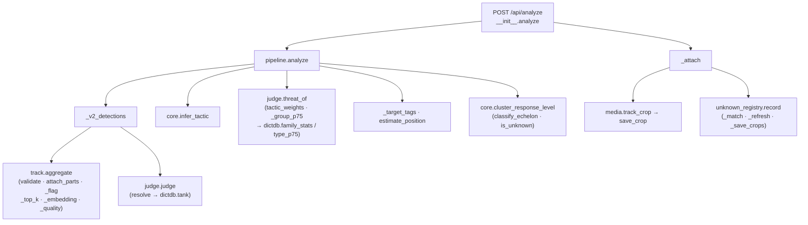

# 05. 함수 목록

파일별 함수 표입니다(파일 순서 = 중요도 순). **위치·입력·호출 위치는 실제 코드에서 자동으로 뽑았습니다**
(`10_코드_라인별_설명/_생성기/gen_functions.py`, 코드가 바뀌면 다시 실행).

- **입력** = 함수 괄호 안 인자(argument, 함수에 넘기는 값). `x=None` 은 안 주면 None(값 없음)으로 시작한다는 뜻.
- **누가 호출하나** = 그 함수를 부르는 코드 위치(`파일:줄`). `HTTP GET /주소` 는 브라우저가 그 주소로 요청하면 실행된다는 뜻.
  6곳이 넘으면 `…` 으로 줄였습니다. "— (스크립트 실행·테스트)" 는 코드 안에서는 부르지 않고 명령줄 실행이나 테스트에서 쓰는 함수입니다.
- JavaScript 함수의 '하는 일'은 함수 첫 줄 주석입니다.

## 호출 관계도 — `analyze` 한 번에 무엇이 어떤 순서로 불리나

순서: ① `pipeline.analyze` 가 `_v2_detections`(트랙 집계 → 판정)를 먼저 하고 ② 군집마다 전술 추정 → 표적마다 위협도·태그 → 군집 대응단계
③ 계산이 끝나면 라우트가 `_attach` 로 crop 저장·레지스트리 저장 ④ `_respond` 로 JSON 응답.

## 파일별 함수 표

